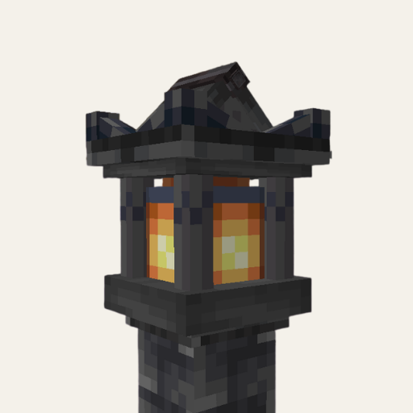
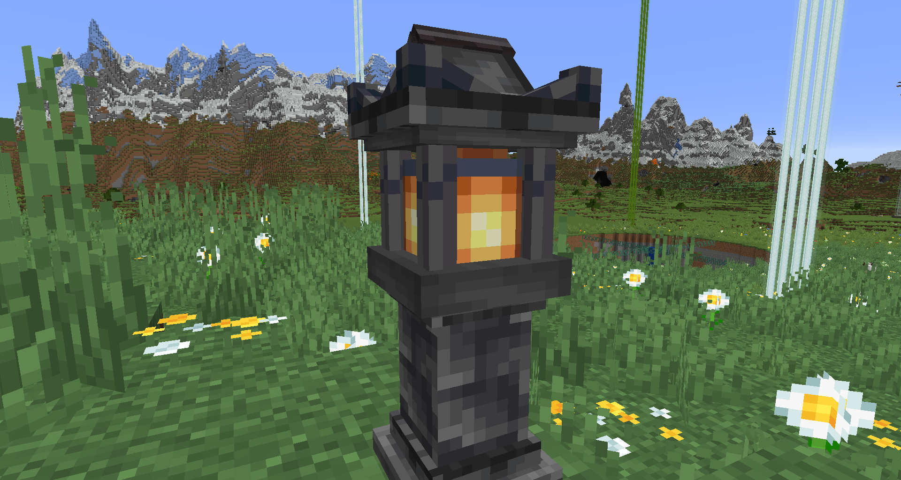
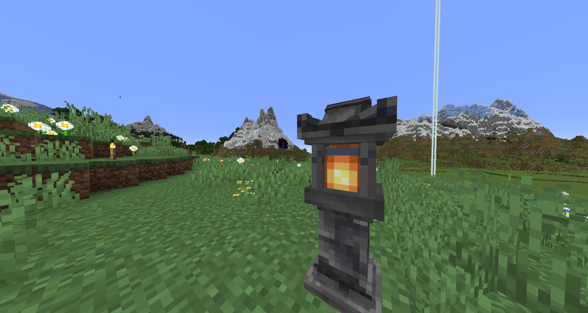

<p align="center"></p>

<h1 align="center">🗿 Torchmanator</h1>

<p align="center"><b>Banishing the dark, automatically.</b></p>

<p align="center">
  
  
  
  
  
  <a href="https://github.com/tariksharabaty/o-lib"></a>
  <a href="https://modrinth.com/organization/oidioomstudio"></a>
  <a href="https://oidioom.com"></a>
</p>

<p align="center"><a href="#-english">🇬🇧 English</a> · <a href="#-türkçe">🇹🇷 Türkçe</a></p>

---

## 🇬🇧 English

> [!IMPORTANT]
> Requires **[O Lib](https://github.com/tariksharabaty/o-lib)** and **Fabric API**.

**Torchmanator** introduces a 2-block tall mechanical statue that automatically monitors and illuminates dark areas within a configurable radius around your base. Never worry about creepers spawning in unlit corners or dark cave mouths again!

---

## ✨ Key Features

- 🗿 **2-Block Tall Animated Statue:** Custom 3D modeled statue with dynamic lantern lighting—the lantern physically illuminates when stocked with torches.
- 🔥 **Multi-Torch Compatibility:** Works seamlessly with:
  - 🪵 **Standard Torches:** Reliable classic illumination.
  - 👻 **Soul Torches:** Blue soul light that keeps Piglins at bay.
  - 🔴 **Redstone Torches:** Automated redstone power grid deployment.
- 📦 **27-Slot Built-in Storage:** Integrated container holds up to 1,728 torches for long-term unattended protection.
- 🔊 **Authentic Trial Chamber Audio:** Plays immersive vault shutter mechanical sounds upon opening and closing the internal container.
- 🧠 **Smart Anti-Grief Placement:**
  - Multi-bracket radial scanning (near, mid, and far range coverage).
  - Strictly places torches only in empty air blocks with solid, sturdy ground beneath.
  - **Never** overwrites or breaks crops, redstone wiring, decorative blocks, or chests.
- ⚙️ **Real-Time Stone UI Config:** Adjust placement radius (16 to 128+ blocks), scan speed/ticks, and light level thresholds in-game through **O Lib** and ModMenu.

---

## 🛠️ Crafting Recipe

Place in a standard Crafting Table:
- **Top Row:** Iron Ingot | Torch / Soul Torch | Iron Ingot
- **Middle Row:** Iron Ingot | Chest | Iron Ingot
- **Bottom Row:** Smooth Stone | Smooth Stone | Smooth Stone

---

## 📥 Installation

1. Install **Minecraft 26.3** with **Fabric Loader**.
2. Install **Fabric API**.
3. Install **O Lib** (required core library).
4. Drop `torchmanator-1.1.2-mc26.3.jar` into your `mods` folder.

## 📸 Screenshots · Ekran Görüntüleri

<table>
<tr><td align="center"></td><td align="center"></td></tr>
</table>

---

## ⬇️ Download

- **Modrinth:** [Oidioom Studio](https://modrinth.com/organization/oidioomstudio)
- **GitHub Releases:** [`torchmanator-1.1.2-mc26.3.jar`](../../releases/latest)

## 🔨 Building from source

Requires **JDK 25**.

```bash
# 1) O Lib is a dependency — publish it to your local Maven first
git clone https://github.com/tariksharabaty/o-lib.git
(cd o-lib && ./gradlew publishToMavenLocal)

# 2) build this mod
./gradlew build
# output: build/libs/torchmanator-1.1.2-mc26.3.jar
```

## 📄 License

[MIT](LICENSE) © 2026 Oidioom / Tarek Sharabaty

---

## 🇹🇷 Türkçe

**Üsler, mağaralar ve yerleşimler için otomatik çevre aydınlatma heykeli.**

> [!IMPORTANT]
> **[O Lib](https://github.com/tariksharabaty/o-lib)** ve **Fabric API** gerektirir.

### ✨ Özellikler

- 2 blok yüksekliğinde animasyonlu heykel
- Farklı meşale türleriyle uyumlu
- 27 slotluk dahili depo (1.728 meşale)
- Trial Chamber kasa sesleri
- Akıllı yerleştirme; yarıçap ve ışık eşiği O Lib ile ayarlanır

### 📥 Kurulum

1. **Minecraft 26.3** için **Fabric Loader** kurun.
2. **Fabric API** ve **O Lib** modlarını `mods` klasörüne ekleyin.
3. `torchmanator-1.1.2-mc26.3.jar` dosyasını `mods` klasörüne atın ve oyunu başlatın.

### ⬇️ İndir

- **Modrinth:** [Oidioom Studio](https://modrinth.com/organization/oidioomstudio)
- **GitHub Releases:** [`torchmanator-1.1.2-mc26.3.jar`](../../releases/latest)

### 📄 Lisans

[MIT](LICENSE) © 2026 Oidioom / Tarek Sharabaty

---

<p align="center"><a href="https://oidioom.com"></a></p>
<p align="center"><b>by Oidioom — Tarek Sharabaty</b><br>
<a href="https://oidioom.com">oidioom.com</a> · <a href="https://github.com/tariksharabaty">GitHub</a> · <a href="https://modrinth.com/organization/oidioomstudio">Modrinth</a> · <a href="https://gear.oidioom.com">Gear</a> · <a href="https://www.instagram.com/oidioom">Instagram</a></p>
